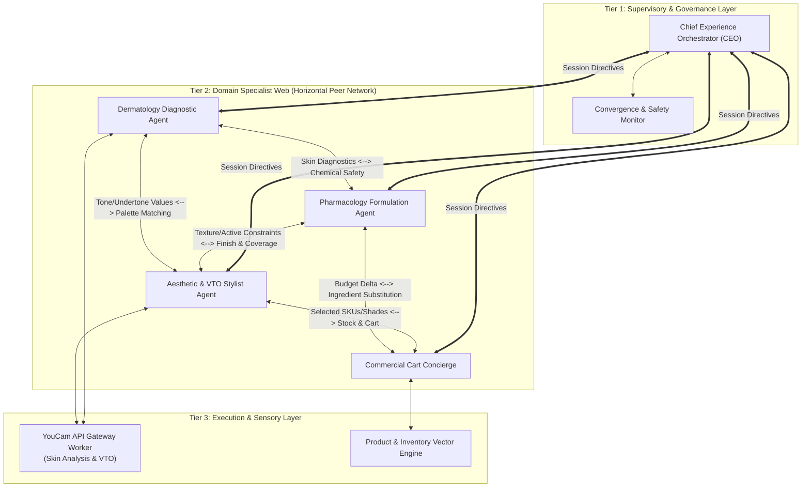

# AuraMesh AI — Multi-Agent Skin Diagnostic & VTO Concierge

> **YouCam API Skin AI & eCommerce Challenge Submission**  
> An autonomous multi-agent system with horizontal and vertical division of labour in a bidirectional web topology, powered by Perfect Corp's YouCam Skin Analysis and Virtual Try-On APIs.

---

## 🌟 Executive Summary

Online beauty and skincare e-commerce faces two chronic friction points:
1. **Clinical Mismatch:** Users buy products with conflicting active ingredients that compromise their skin barrier.
2. **Shade Mismatch & Returns:** Over 30% of online foundation and lip purchases are returned due to inaccurate tone matching on screen.

**AuraMesh AI** solves this through a decentralized **Bidirectional Multi-Agent Web Architecture**. Instead of a simple prompt wrapper or rigid sequential pipeline, specialized agents in Dermatology, Pharmacology, Aesthetics, and Commerce negotiate autonomously across tiers and peer channels to deliver clinical efficacy, aesthetic harmony, and financial constraint satisfaction.

---

## 🏛️ System Architecture: Bidirectional Web Topology



---

## 🚀 Key Features

* **🔬 Deep Skin Telemetry via YouCam AI:** Real-time extraction of 7 clinical vectors: Acne, Pores, Texture, Wrinkles, Spots, Dark Circles, and Erythema (Redness), plus Skin Age and Fitzpatrick classification.
* **💄 True-Match Virtual Try-On (VTO):** Interactive before/after split slider applying YouCam VTO foundation, lip velvet, and cheek flush with real-time undertone calibration.
* **🤝 Peer-to-Peer Agent Negotiation:** When an initial routine exceeds the user's budget ceiling, the Commercial Agent negotiates directly with the Formulation Agent to substitute premium patented actives with clinically equivalent bio-botanicals (e.g. Bakuchiol Peptide dupe for expensive Retinaldehyde), achieving target budget without sacrificing barrier safety.
* **🛡️ Zero-Crash Sponsor API Guard:** Full 6-second timeout wrappers, automatic fallback recovery, and realistic simulated diagnostic telemetry so Wi-Fi drops or missing API keys never crash a live demo.
* **⚡ Live Topological Visualizer & Event Log:** Visualizes active messages, hop counts, and negotiation envelopes (`DELEGATE`, `INFORM`, `PROPOSE`, `NEGOTIATE`, `CONSENSUS`) in real time.

---

## 🛠️ Tech Stack

* **Frontend & UI:** React 19, TypeScript, Tailwind CSS, Lucide Icons, Canvas Confetti
* **Architecture:** Custom Bidirectional Multi-Agent Event Bus with Hop Invariant Protection
* **Sponsor Integrations:** Perfect Corp YouCam APIs (`/task/skin-analysis`, `/task/makeup-vto`)
* **Build System:** Vite 6, PostCSS, Autoprefixer

---

## ⚡ Quickstart & Local Setup

```bash
# 1. Navigate to the project directory
cd youcam-skin-ai-agent

# 2. Install dependencies
npm install

# 3. Start local development server
npm run dev

# 4. Production build
npm run build
```

The application runs immediately at `http://localhost:3000`. By default, it operates in **Zero-Crash Demo Guard Mode** with pre-seeded personas (Maya, Elena, Jordan) and allows entering a live YouCam API key via the top-bar key modal at any time.
