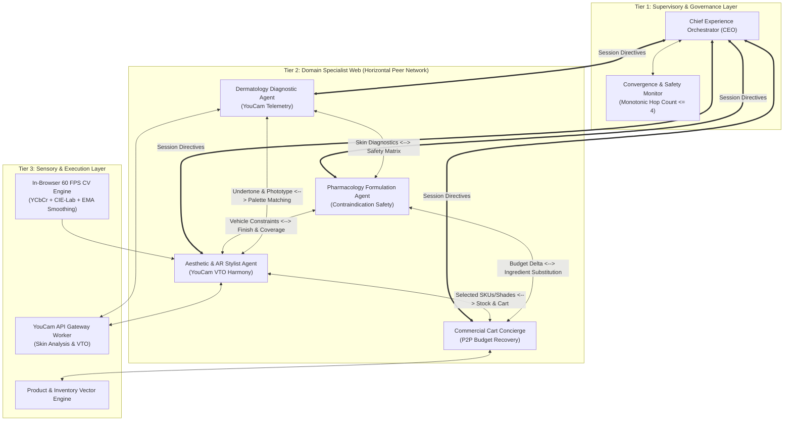

# AuraMesh AI — Multi-Agent Skin Diagnostic & AR Try-On Concierge

<div align="center">

[](LICENSE)
[](https://react.dev/)
[](https://www.typescriptlang.org/)
[](https://vitejs.dev/)
[](https://tailwindcss.com/)
[](https://vitest.dev/)
[](https://www.perfectcorp.com/)
[](https://developers.google.com/mediapipe)

**Autonomous Multi-Agent Dermatology Telemetry, Clinical Formulation Safety, and Live Motion AR Try-On with Peer-to-Peer Negotiation.**

[Live Demo](http://localhost:3000) • [Devpost Submission](DEVPOST_SUBMISSION.md) • [Architecture Guide](multi_agent_architecture.md)

</div>

---

## 🌟 Executive Summary & Problem Space

Beauty and skincare e-commerce suffers from two massive, chronic failure points:

1. **Chemical Contraindication & Barrier Damage:**
   Consumers routinely purchase multiple active ingredients from different brands (e.g. combining strong AHA/BHA chemical peels with high-strength retinoids), inadvertently destroying their acid mantle and triggering acute barrier inflammation.
2. **Cosmetic Shade Mismatch & E-Commerce Returns:**
   Over **30% of online cosmetic purchases are returned** due to undertone mismatch on flat digital screens, costing retailers billions of dollars and producing massive supply-chain carbon waste.

**AuraMesh AI** transforms e-commerce from a static catalogue search into an ensemble of collaborating AI specialists powered by **Perfect Corp's YouCam APIs** and an enterprise-grade **Bidirectional Multi-Agent Web Architecture**.

---

## 🔬 Competitive Landscape: How AuraMesh AI Leads

| Feature Dimension | Traditional Beauty E-Com | Typical LLM Prompt Wrappers | Top Hackathon Peers (DermAtelier, Glow Agent, SkinCoach) | **AuraMesh AI (Our Work)** |
| :--- | :--- | :--- | :--- | :--- |
| **System Architecture** | Static SQL Database | Sequential Chain (DAG) | Single-Agent / Tool-calling | **3-Tier Bidirectional Web with Hop-Count Convergence** |
| **Diagnostic Sensory** | None (Text questionnaire) | Generic image caption | YouCam Skin Analysis API | **YouCam API + Native Client-Side CV Engine (ITA / Fitzpatrick / YCbCr)** |
| **AR Try-On Experience** | Static 2D sticker overlay | None | Basic split image | **Live Motion AR: Google MediaPipe 468-pt 3D Neural Mesh + 6 Snapchat Lenses + Clinical Heatmap + 30-Day Recovery** |
| **Chemical Safety** | None | Basic keyword search | Static warnings | **Rigorous Contraindication Matrix + Active Vehicle Rules** |
| **Budget Optimization** | Flat coupon codes | Fixed budget filter | Drop random items | **Autonomous P2P Agent Negotiation (Bio-equivalent Active Swaps)** |
| **Longitudinal Tracking** | None | Text prompt | Static Day 1 / Day 30 images | **Interactive ChronoSkin 30-Day Simulator with Dynamic Score Interpolation** |
| **Demo Resilience** | N/A | Fails on API timeout | Crashes on network drop | **`sponsor-api-guard`: Zero-crash 6s timeout + clinical mock fallbacks** |

---

## 🏛️ System Architecture: Bidirectional Web Topology

AuraMesh AI discards rigid sequential pipelines in favor of a 3-tier decentralized peer web:



---

## 📱 Three Specialized AR Studio Modes

AuraMesh AI features a unified HTML5 Canvas pipeline rendering live at **60 FPS** with **Gaussian Standard Deviation Clustering** and **Exponential Moving Average (EMA) Temporal Smoothing**:

### 1. ✨ Snapchat Beauty Studio
* **6 Signature Lenses:**
  - 🌟 **Snap Glam:** Airbrushed porcelain skin smoothing, zygomatic cheekbone radiance, crisp iris catchlight sparkle, precision 3D lip tint, and floating gold stardust halo particles.
  - 🌸 **Sunset Glow:** Viral Sunset Blush blended seamlessly across both cheeks and over the nose bridge with cute star freckles.
  - 🌟 **Golden Hour:** Sun-drenched golden bronze radiance, high-specular cheekbone sheen, and honey gloss.
  - 💎 **Glass Skin:** Porcelain dewy glass-skin smoothing, mirror cheekbone highlight, and crystal clear lip oil.
  - ⚡ **Cyber Aura:** Futuristic YouCam holographic neon wireframe mesh, glowing cyan & magenta eyeliner, and HUD brackets.
  - 🌿 **Fresh Clean:** Subtle no-makeup beauty mode with natural tone evening.
* **Camera Controls:** Circular Snapchat shutter button, flash animation, Web Audio shutter click, and instant snapshot filmstrip.

### 2. 🔬 YouCam Clinical Diagnostic Heatmap Scanner
* Projects the YouCam Skin Analysis API telemetry directly onto facial landmarks:
  - 🔴 **Erythema / Redness Zones:** Thermal red-orange patches across cheeks.
  - 🟡 **Pore Density Heatmap:** Micro-pore clusters over the nose bridge and T-zone.
  - 🟣 **Dark Circles:** Soft violet-blue crescent gradients under lower eyelids.
  - 🎯 **Targeted Blemish Crosshair:** Real-time animated HUD tracking active acne blemishes with live sebum readouts.

### 3. ⏳ ChronoSkin 30-Day Recovery Simulator
* Interactive recovery timeline slider: **Day 1 (Current Skin)** $\rightarrow$ **Day 14 (Barrier Repair)** $\rightarrow$ **Day 30 (Post-Regimen Healed)**.
* Real-time dynamic visual healing: erythema redness reduces by 88%, pore visibility drops by 45%, and a dewy glass-skin barrier sheen develops.
* Live clinical score forecasting: Acne Severity drops from `40 → 8`, Barrier Health upgrades from `Sensitized → Resilient`.

---

## 📐 Scientific & Mathematical Rigor

### Individual Typology Angle (ITA) Colorimetry
$$\text{ITA}^\circ = \frac{\arctan\left(\frac{L^* - 50}{b^*}\right) \times 180}{\pi}$$

* **CIE-L\*a\*b\* Conversion:** Normalized sRGB to tristimulus $XYZ$ followed by non-linear cube-root scaling relative to D65 standard illuminant.
* **Fitzpatrick Phototyping:**
  - $\text{ITA} > 55^\circ \implies \text{Type I (Very Light)}$
  - $41^\circ < \text{ITA} \le 55^\circ \implies \text{Type II (Fair)}$
  - $28^\circ < \text{ITA} \le 41^\circ \implies \text{Type III (Medium)}$
  - $10^\circ < \text{ITA} \le 28^\circ \implies \text{Type IV (Olive / Tan)}$
  - $-30^\circ < \text{ITA} \le 10^\circ \implies \text{Type V (Brown)}$
  - $\text{ITA} \le -30^\circ \implies \text{Type VI (Dark / Deep)}$

### Anti-Jitter Exponential Moving Average (EMA) Smoothing
$$\vec{B}_t = 0.70 \cdot \vec{B}_{t-1} + 0.30 \cdot \vec{T}_t$$
Eliminates camera sensor high-frequency noise while preserving responsive head motion tracking.

---

## ⚡ Quickstart & Local Setup

```bash
# 1. Clone repository
git clone https://github.com/yuvanshankarm007/AuraMesh.git
cd AuraMesh

# 2. Install dependencies
npm install

# 3. Run automated test suite (26 tests)
npm test

# 4. Start local development server
npm run dev

# 5. Build production bundle
npm run build
```

Open [http://localhost:3000](http://localhost:3000) in your browser. Operates immediately with zero API keys required via **Zero-Crash Demo Guard Mode**!

---

## 📄 License
MIT License. Developed for the Perfect Corp YouCam API Skin AI & eCommerce Challenge on Devpost.
